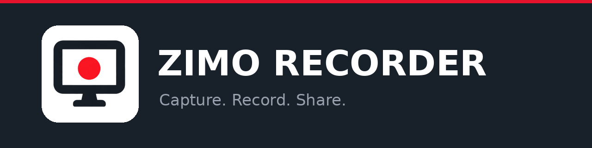
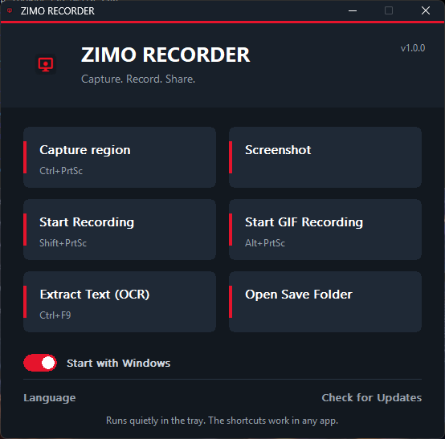
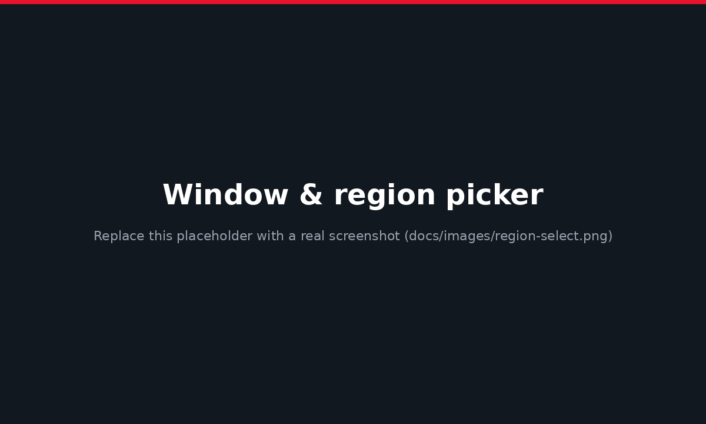
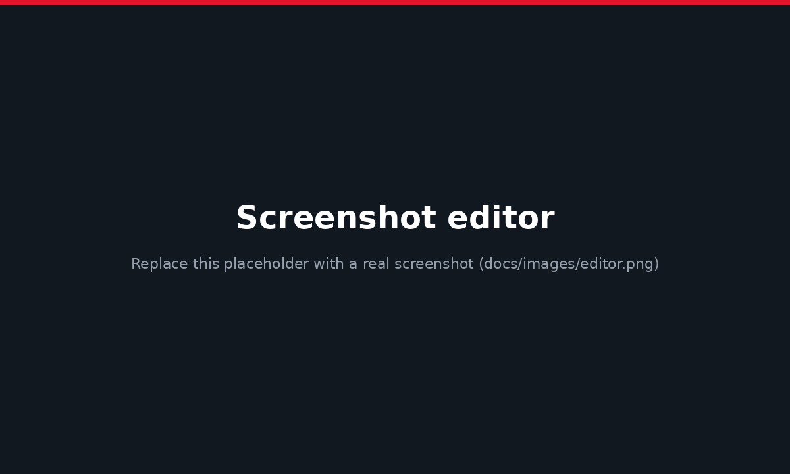

<div align="center">



# ZIMO RECORDER

### Screenshot tool & screen recorder for Windows 10 and 11

Capture any window or region, record your screen as **MP4** or **GIF**, edit in one click,
and copy text out of anything on screen with **OCR**. Fast, lightweight and available in **15 languages**.

<br>

<a href="https://github.com/zimobyte/ZimoRecorder/releases/latest"></a>

<br><br>

[](https://github.com/zimobyte/ZimoRecorder/releases/latest)
[](https://github.com/zimobyte/ZimoRecorder/releases)


[](https://github.com/zimobyte/ZimoRecorder/stargazers)

**[Download](#download--install)** &nbsp;&bull;&nbsp; **[How to use](#how-to-use)** &nbsp;&bull;&nbsp; **[Features](#features)** &nbsp;&bull;&nbsp; **[Shortcuts](#keyboard-shortcuts)** &nbsp;&bull;&nbsp; **[FAQ](#faq)** &nbsp;&bull;&nbsp; **[Changelog](CHANGELOG.md)**

</div>

---

<p align="center">
  
  &nbsp;
  
</p>

## What is ZIMO RECORDER?

ZIMO RECORDER is a lightweight **screenshot tool and screen recorder for Windows 10 and Windows 11**. It sits quietly in the system tray, so one keyboard shortcut is all it takes to capture a window, a region or the whole screen, record a video or a GIF, and extract text from the screen. Nothing is uploaded: files are saved on your own computer.

## Download & install

| | |
|---|---|
| **Requires** | Windows 10 or Windows 11 (64-bit) |
| **Installer** | `ZimoRecorder-Setup-x.y.z.exe` &mdash; installs for your user only, no administrator rights needed |
| **Size** | Small and fast: no background services, no account |

1. Open the [latest release](https://github.com/zimobyte/ZimoRecorder/releases/latest) and download the installer.
2. Run it. Keep **Create a desktop shortcut** and **Start with Windows** ticked, then finish.
3. Press a shortcut and capture. That's it.

> Windows may show a SmartScreen notice for new apps. Choose **More info**, then **Run anyway**.

## How to use

**Take a screenshot**
1. Press `Ctrl` + `PrtSc` (or `Ctrl` + `F6`).
2. Move the mouse over a window to highlight it and click, or drag to select any area. Right-click while dragging to start over.
3. The editor opens: add arrows, text or blur, then **Save** or **Copy**. A notification appears; click it to open the folder with your file selected.

**Record your screen**
1. Press `Shift` + `PrtSc` (or `Ctrl` + `F7`) and pick the window or area.
2. Recording starts. Press the same shortcut again to stop.
3. Your MP4 is saved and a notification lets you open its folder.

**Make a GIF**: press `Alt` + `PrtSc` (or `Ctrl` + `F8`), choose the area, press it again to finish.

**Copy text from the screen (OCR)**: press `Ctrl` + `F9`, select the text, and it is copied to your clipboard.

Prefer clicking? Open ZIMO RECORDER from the desktop shortcut or tray icon and use the big buttons.

<p align="center">
  
</p>

## Features

| | |
|---|---|
| **Capture** | Full screen, a single window (highlighted automatically) or a free region with live size display |
| **Record video** | MP4 recording of a window or region, with pause and resume |
| **Record GIF** | Turn any part of your screen into an animated GIF |
| **Edit instantly** | Line, arrow, text and blur tools, undo, save or copy in one click |
| **Text recognition (OCR)** | Select an area and get the text on your clipboard |
| **Always ready** | Starts with Windows (optional) and works in the background, even before you open the window |
| **Smart notifications** | Click the "saved" card to open the folder with the file selected |
| **Sharp on any display** | High-DPI and multi-monitor aware |
| **Built-in updates** | Update notices with release notes, delivered securely and verified before install |
| **15 languages** | English, Persian, German, Russian, French, Spanish, Turkish, Arabic, Chinese, Italian, Portuguese, Japanese, Korean, Hindi, Dutch |
| **Private** | No account, no cloud, no telemetry. Your files stay on your computer |

## Keyboard shortcuts

| Action | Shortcut | Backup shortcut |
|---|---|---|
| Screenshot (window or region) | `Ctrl` + `PrtSc` | `Ctrl` + `F6` |
| Record video (MP4), press again to stop | `Shift` + `PrtSc` | `Ctrl` + `F7` |
| Record GIF, press again to stop | `Alt` + `PrtSc` | `Ctrl` + `F8` |
| Extract text from the screen (OCR) | `Ctrl` + `F9` | |

Left-click the tray icon to open the main window, right-click for the menu.

## FAQ

**How do I take a screenshot of a single window on Windows?**
Press `Ctrl` + `PrtSc`, hover over the window until it is highlighted, and click.

**How do I record my screen on Windows 11?**
Press `Shift` + `PrtSc`, choose a window or area, and press the shortcut again to stop. The MP4 is saved automatically.

**Where are my screenshots and recordings saved?**
Screenshots go to `Pictures\ZimoRecorder` and videos and GIFs to `Videos\ZimoRecorder`. Use **Open Save Folder** in the main window, or click the notification.

**Does ZIMO RECORDER upload my files?**
No. Nothing leaves your computer.

**Does it work on Windows 10?**
Yes: Windows 10 and Windows 11.

**Can it record audio?**
Not yet. Audio capture is on the roadmap (see below).

**Why do video and GIF recording need FFmpeg?**
Recording uses [FFmpeg](https://ffmpeg.org/). The installer includes it when it was available at build time; otherwise place `ffmpeg.exe` next to `ZimoRecorder.exe`.

**Which languages are supported?**
15, switchable at any time from the main window.

## Roadmap

- Audio recording (microphone and system sound)
- More editor tools: shapes, highlighter, numbered steps, crop
- Video editor: trim, cut, speed, text and arrows
- Settings window and capture history

Ideas are welcome: [open a feature request](https://github.com/zimobyte/ZimoRecorder/issues/new/choose).

## Build from source

Requirements: Windows, a C++17 compiler (MinGW-w64 / GCC), CMake and Ninja.

```
cmake -B build -G "Ninja"
cmake --build build
```

The executable is created at `build/ZimoRecorder.exe`. To build the installer, open `installer/ZimoRecorder.iss` in [Inno Setup](https://jrsoftware.org/isinfo.php) and compile. Names, version and shortcuts live in one file: `src/Config.h`.

## Publishing updates (maintainers)

Updates are delivered from the publisher's own server and verified with a digital signature and SHA-256 before installing.

1. One-time: `pip install cryptography`, run `python tools/update_keygen.py`, keep `update_private_key.pem` secret, and paste the printed public key into `UPDATE_PUBLIC_KEY_HEX` in `src/Config.h`.
2. Each release: raise `APP_VERSION` in `src/Config.h`, rebuild, then run `python tools/make_release.py --exe build/ZimoRecorder.exe --version 1.1.0 --notes-en "What's new"`.
3. Upload the two files from `release/` to the update server, `latest.txt` last.

## Contributing

Bug reports and ideas are welcome. Please use the [issue templates](https://github.com/zimobyte/ZimoRecorder/issues/new/choose).

---

<div align="center">

If you like ZIMO RECORDER, please give it a &#11088; &mdash; it helps others find it.

Made with care by **Zimo** &nbsp;&middot;&nbsp; &copy; 2026 Zimo. © 2026 Zimo. Released under the MIT License.

</div>
